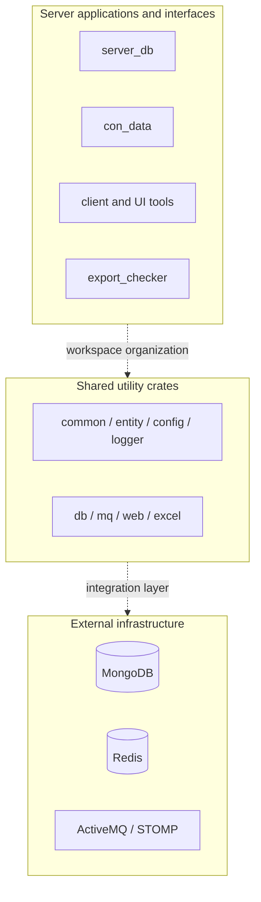

# AviRust

A modular Rust platform for data integration, message-driven processing, and database connectivity, with server applications, shared utilities, and user interfaces organized in a Cargo workspace.


## Overview

AviRust brings together data-processing applications, database and messaging utilities, configuration, logging, and user-facing tools in a single Rust workspace. The project separates executable applications from reusable infrastructure components and supports Linux development and Windows cross-compilation for selected applications.

## Architecture

The following diagram represents the workspace organization, rather than a verified runtime communication graph.



## Workspace structure

| Path | Purpose |
| --- | --- |
| `server/server_db` | Database-oriented server application; default Cargo workspace member |
| `server/con_data` | Data processing application |
| `server/client` | Client application |
| `server/ui`, `server/import_ui`, `server/config_ui` | User interface and configuration tools |
| `server/export_checker` | Export-checking application |
| `utility/common`, `utility/entity` | Shared helpers and entities |
| `utility/config`, `utility/logger` | Configuration and logging |
| `utility/db`, `utility/mq` | Database and message-queue utilities |
| `utility/web`, `utility/excel` | Web and spreadsheet utilities |
| `tests/` | Test-related files |
| `offline_files/` | Supporting assets used by build targets |
| `Makefile` | Build, test, asset preparation, and packaging commands |

## Technology stack

Rust, Cargo, MongoDB, Redis, ActiveMQ/STOMP, Make, and MinGW for Windows cross-compilation.

## Getting started

Install the Rust toolchain and Cargo using [rustup](https://rustup.rs/). Some workspace members may require additional native or graphical dependencies.

```bash
git clone https://github.com/AliBigdeli0/avirust.git
cd avirust
cargo build -p server_db --release
cargo build -p con_data --release
```

To compile or test the full workspace (after installing its required dependencies):

```bash
cargo build --workspace
cargo test --workspace
```

The Makefile also contains application-specific build and asset preparation targets.

## Runtime configuration

Configure the relevant services before launching an application. Example local values for `con_data` (Bash):

```bash
export MED_REDIS_URL=redis://localhost:6379
export MED_AMQ_STOMP_ADDRESS=tcp://localhost:61613
export MED_MONGO_CONN_STR=mongodb://localhost:27017/
export MED_WELL_ID=12345
cargo run -p con_data
```

Replace the example identifier and endpoints with values appropriate for your environment. The existing documentation also lists `MED_AMQ_ADDRESS`; confirm the applicable variable for each executable. Supply authentication configuration securely when required, and never commit real credentials or deployment identifiers.

## Windows cross-compilation

On Linux, install a compatible MinGW-w64 toolchain and add the Rust target:

```bash
rustup target add x86_64-pc-windows-gnu
cargo build --target x86_64-pc-windows-gnu -p server_db --release
```

Configure the linker in `.cargo/config.toml` if needed:

```toml
[target.x86_64-pc-windows-gnu]
linker = "x86_64-w64-mingw32-gcc"
```

## Technical documentation

See [technical documentation](docs/README.md) for additional operational and build notes once the original README has been relocated and sanitized.

## Engineering focus

- Modular Rust workspace design and reusable infrastructure crates
- Database and message-broker integration
- Environment-based application configuration
- Cross-platform build and packaging workflows
- Separation of application logic and shared utilities

## Author

[Ali Bigdeli](https://github.com/AliBigdeli0)
